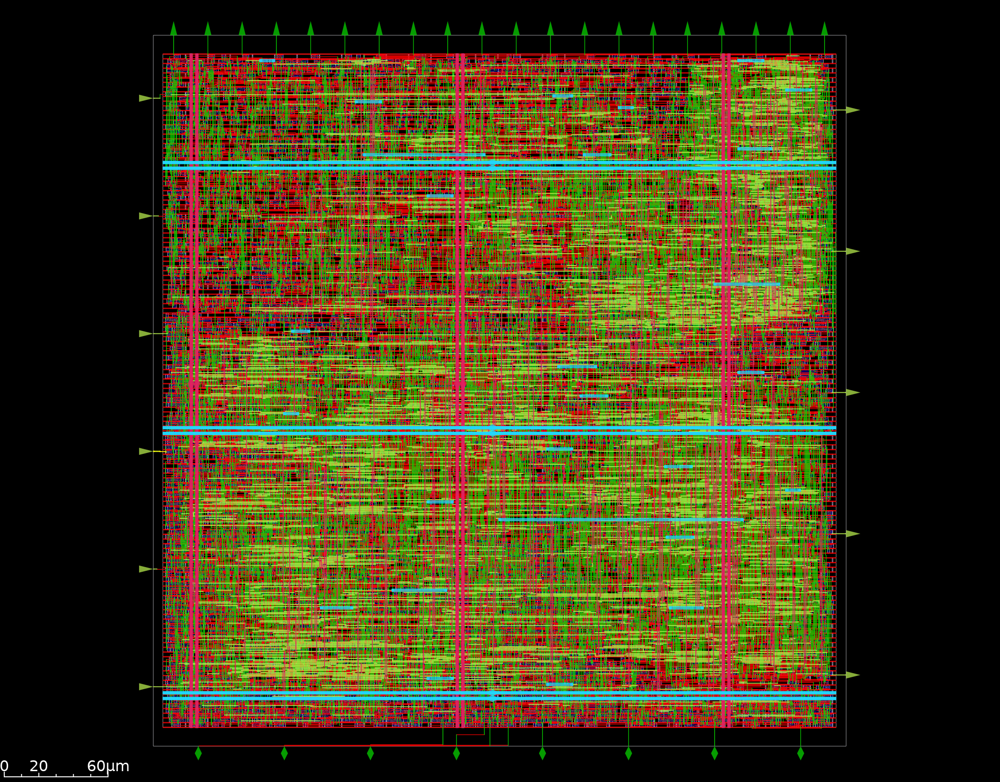

# Diseño Físico VLSI con LibreLane

## Micro8088 (Síntesis → GDS) con herramientas Open Source

Flujo de diseño físico para el procesador **8088** (`Micro8088`) usando **LibreLane** y la tecnología **sky130**.

Este repositorio **no forma parte de ningún curso**: Es un proyecto personal para probar el flujo físico del 8088 con herramientas open source, como continuación del proyecto [Introduction_to_VLSI_Project](https://github.com/Jeffrey823/Introduction_to_VLSI_Project), donde se hizo el mismo diseño con herramientas de Synopsys.

- **Autor:** Jeffrey Salas
- **Diseño:** `Micro8088` (procesador 8088 descrito en Verilog, proporcionado por el profesor Kervin Sánchez en el curso Introducción al Diseño de Circuitos Integrados, TEC)
- **Tecnología:** Sky130 (PDK por defecto de LibreLane)
- **Herramienta:** [LibreLane](https://fossi-foundation.org/librelane) 3.0.16 (Docker) — [repositorio en GitHub](https://github.com/librelane/librelane)

## Layout obtenido Micro8088



---

## Descripción

El objetivo es llevar el `Micro8088` por el flujo físico completo de [LibreLane](https://fossi-foundation.org/librelane) ([repositorio](https://github.com/librelane/librelane)), desde la síntesis hasta el archivo GDS, y obtener el layout del diseño. Es el mismo Verilog del proyecto con Synopsys, pero con otro conjunto de herramientas y otra tecnología, por lo que las constraints se adaptaron.

## Estructura del repositorio

```
└── 8088/
    ├── config.json         # Configuración del flujo de LibreLane
    ├── constraints.sdc     # Constraints de timing (OpenSTA)
    ├── pin_order.cfg       # Orden de los pines por lado del die
    ├── src/                # Archivos Verilog del diseño
    └── runs/
        └── RUN_2026-11-06_01-22-03/   # Resultados de la corrida (incluye layout.png)
```

> **En `src/` solo se incluye el archivo top**, no el resto de los archivos Verilog del 8088 (diseño del profesor).

## Archivos de configuración

### `config.json`

| Variable           | Valor                    | Descripción                                   |
|--------------------|--------------------------|-----------------------------------------------|
| `DESIGN_NAME`      | `Micro8088`              | Módulo top del diseño                         |
| `VERILOG_FILES`    | `dir::src/*.v`           | Todos los `.v` de la carpeta `src`            |
| `CLOCK_PORT`       | `CLK`                    | Puerto de reloj                               |
| `CLOCK_PERIOD`     | `100`                    | Periodo de reloj en ns (10 MHz)               |
| `PNR_SDC_FILE`     | `dir::constraints.sdc`   | Constraints usadas en place and route         |
| `SIGNOFF_SDC_FILE` | `dir::constraints.sdc`   | Constraints usadas en signoff                 |
| `FP_CORE_UTIL`     | `50`                     | Utilización del core en el floorplan (%)      |
| `IO_PIN_ORDER_CFG` | `dir::pin_order.cfg`     | Archivo con el orden de los pines             |

### `constraints.sdc`

Adaptado de las constraints de Design Compiler (SAED90) del proyecto anterior:

- Reloj `CLK` con periodo de 100 ns (debe coincidir con `CLOCK_PERIOD` de `config.json`).
- `set_clock_uncertainty` de 0.25 ns para setup y hold.
- Input/output delay de 20 % del periodo (máx. 20 ns, mín. 0 ns). Como OpenSTA no tiene `remove_from_collection`, el puerto `CLK` se excluye de los inputs con `lreplace`.
- `set_max_transition 1.5` (el 0.2 ns de SAED90 es muy exigente para las celdas de sky130).
- `set_max_fanout 10`.

### `pin_order.cfg`

| Lado         | Pines                                |
|--------------|--------------------------------------|
| Oeste (`#W`) | `CLK`, `RST`, `HOLD`, `TEST`, `INTR`, `NMI` |
| Sur (`#S`)   | `DataBus.*` (bus de datos)           |
| Este (`#E`)  | `RD`, `WR`, `IOM`, `INTA`, `HLDA`    |
| Norte (`#N`) | `Dir.*` (bus de direcciones)         |

## Diferencias respecto al proyecto con Synopsys

| Aspecto                | Introduction_to_VLSI_Project            | Este repositorio                   |
|------------------------|-----------------------------------------|------------------------------------|
| Herramientas           | Design Compiler + IC Compiler II        | LibreLane                          |
| Tecnología             | SAED 90 nm                              | sky130 (PDK por defecto de LibreLane) |
| Periodo de reloj       | 1 ns                                    | 100 ns                             |
| Clock uncertainty      | 0.05 ns                                 | 0.25 ns                            |
| Input/output delay     | 20 % del periodo (0.2 ns)               | 20 % del periodo (20 ns)           |
| Transición máxima      | 0.2 ns                                  | 1.5 ns                             |
| Utilización            | 98 % (objetivo)                         | `FP_CORE_UTIL` = 50 %              |

## Resultados

| Métrica                | Valor |
|------------------------|-------|
| Periodo de reloj       | 100 ns |
| Celdas                 | —     |
| Peor slack setup       | —     |
| Peor slack hold        | —     |
| Utilización final      | —     |
| Potencia               | —     |
| DRC                    | —     |

Los reportes completos de cada etapa están en `8088/runs/RUN_2026-11-06_01-22-03/`.


## Cómo reproducir

Requiere Docker y LibreLane 3.0.16.

1. Colocar todos los archivos Verilog del `Micro8088` en `8088/src/`.
2. Entrar a la carpeta del diseño e iniciar LibreLane en modo Docker:

   ```
   cd 8088
   librelane --dockerized
   ```

3. Dentro del contenedor, correr el flujo:

   ```
   librelane config.json
   ```

Los resultados se generan en `runs/RUN_<fecha>/`.

## Cómo ver el Layout

Al terminar el flujo, el layout se puede abrir de cualquiera de estas formas:

- **OpenROAD GUI desde LibreLane** (dentro de `8088`):

  ```
  librelane --last-run --flow openinopenroad config.json
  ```

- **KLayout desde LibreLane**:

  ```
  librelane --last-run --flow openinklayout config.json
  ```

- **OpenROAD GUI directamente**: Si ya se cerró la terminal de LibreLane, se debe volver a abrir con `librelane --dockerized` (dentro de `8088`) y luego ejecutar:

  ```
  openroad -gui
  ```

  Luego, en la GUI, buscar y abrir el archivo `.odb` dentro de `runs/RUN_<fecha>/`.


## Trabajo futuro: Acercar el flujo al de Synopsys

La configuración actual usa casi todo por defecto. El flujo con Synopsys (`place_and_route.tcl`) tenía más control sobre el floorplan, la densidad, los bloqueos de routing, el power mesh y las capas del reloj. Esto es lo que se planea trasladar a `config.json` y `constraints.sdc`:

| Flujo con Synopsys (ICC2)                                         | Posible equivalente en LibreLane                                              |
|-------------------------------------------------------------------|-------------------------------------------------------------------------------|
| Floorplan de 450 × 253 (≈ 16:9) con utilización inicial de 90 %   | `FP_SIZING: "absolute"` con `DIE_AREA`, o `FP_CORE_UTIL` con `FP_ASPECT_RATIO` |
| Mayor densidad (utilización final de 98 %)                        | Subir `FP_CORE_UTIL` y `PL_TARGET_DENSITY_PCT`                                |
| Bloqueo de routing de señales en M5–M9                            | `ROUTING_OBSTRUCTIONS` (formato `capa llx lly urx ury`) o limitar con `RT_MAX_LAYER` |
| Power mesh con M5/M6, `width` 1 y `pitch` 24                      | `FP_PDN_VWIDTH`, `FP_PDN_HWIDTH`, `FP_PDN_VPITCH`, `FP_PDN_HPITCH`            |
| Reloj ruteado entre M4 y M5                                       | `RT_CLOCK_MIN_LAYER` y `RT_CLOCK_MAX_LAYER`                                   |
| `set_clock_latency 0`                                             | Agregarlo a `constraints.sdc`                                                 |

Algunas cosas no se pueden copiar directamente porque dependen de la tecnología: Sky130 solo tiene capas `met1` a `met5` (no existen M6–M9), y el voltaje de 0.70 V y los archivos `.tluplus` son de SAED90 e ICC2. Los nombres de variables salen de la documentación de LibreLane/OpenLane 2 y hay que confirmarlos con la versión 3.0.16.

## Créditos

- Diseño `Micro8088` proporcionado por el profesor Kervin Sánchez en el curso Introducción al Diseño de Circuitos Integrados (TEC).
- Flujo de diseño físico: [LibreLane](https://fossi-foundation.org/librelane) ([GitHub](https://github.com/librelane/librelane)).